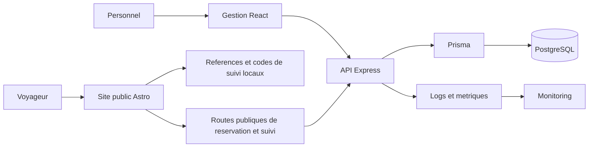
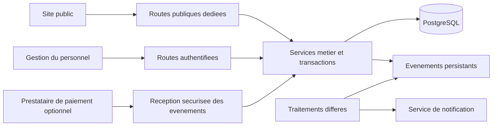
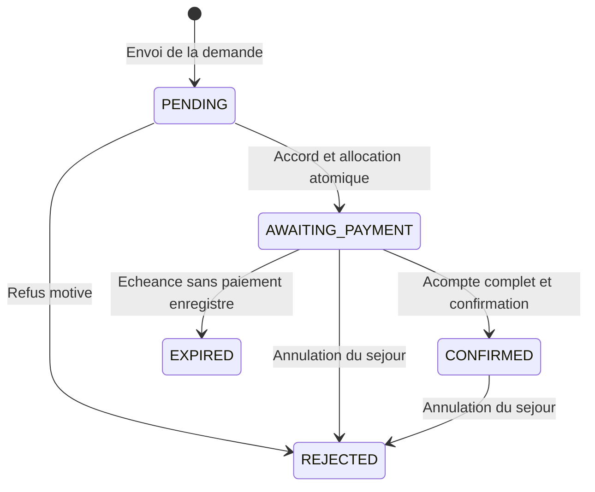
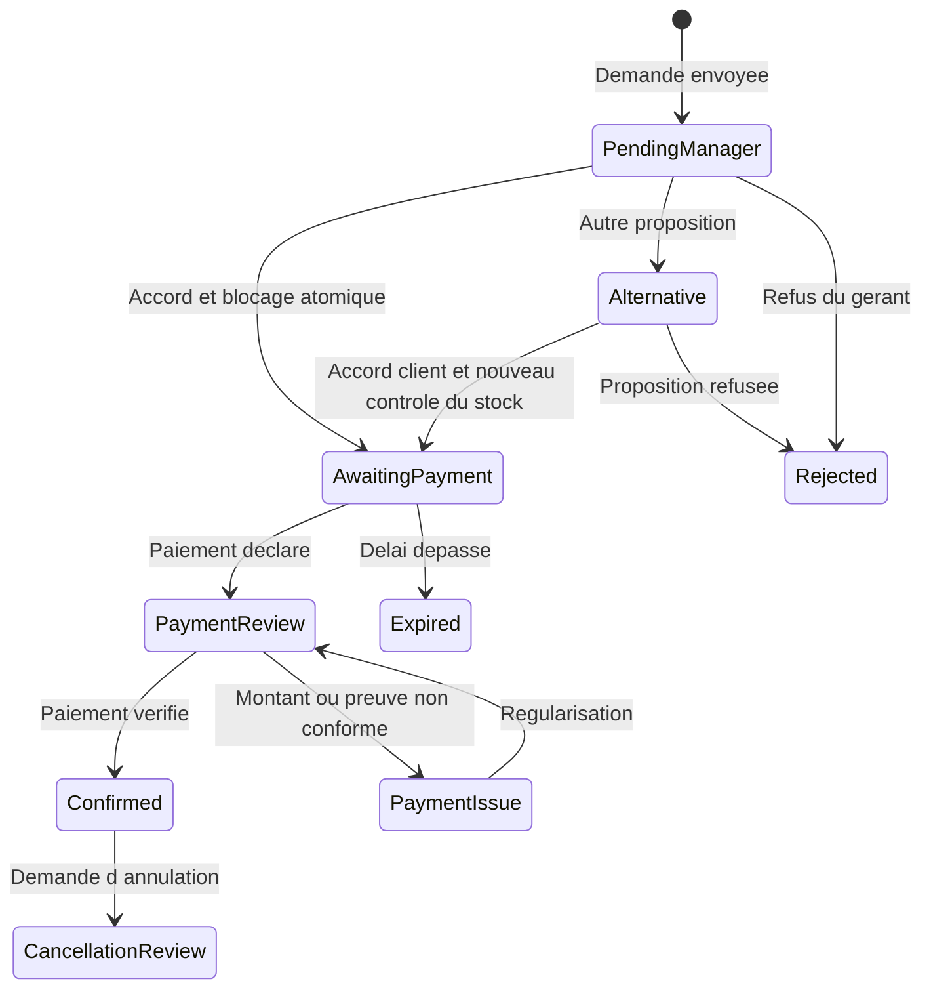
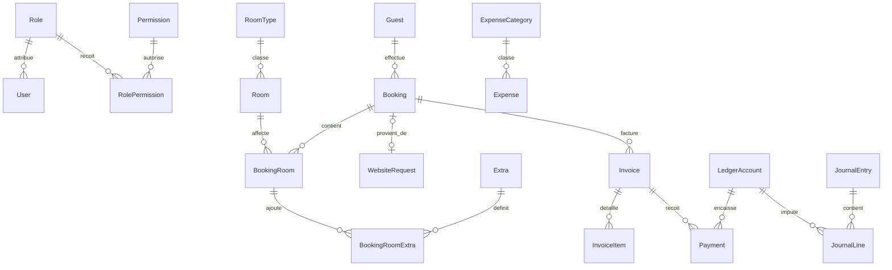

# Cahier de conception — Natura Lodge

**Projet :** application de gestion hôtelière et réservation en ligne Natura Lodge Manambato  
**Version du document :** 1.1  
**Date :** 7 novembre 2026  
**Statut :** raccordement implémenté dans le dépôt ; recette complète et mise en service restant à effectuer  
**Référence technique :** code présent dans le dépôt à la date de rédaction ; packages de gestion en version 2.3.0.

## 1. Objet du document

Ce cahier décrit les utilisateurs, les fonctions, les règles métier, les données et l’architecture de Natura Lodge. Il sert de référence pour poursuivre le développement et préparer la recette, en particulier le raccordement du site public à la gestion hôtelière.

Il distingue trois niveaux :

| Niveau | Signification |
| --- | --- |
| Existant | Fonction ou structure présente dans le code ; cela ne constitue pas une certification du fonctionnement en production. |
| Prototype historique | Ancien parcours local, remplacé par les appels API ; les anciennes simulations ne sont pas importées. |
| Cible | Évolution non encore implémentée : alternatives, compte client, notifications ou paiement en ligne, notamment. |

Les politiques commerciales encore inconnues sont identifiées comme décisions ouvertes. Aucune condition d’annulation ni intégration de paiement n’est réputée validée par ce document.

## 2. Contexte et objectifs

Natura Lodge est un hébergement situé à Manambato, Madagascar. Le produit associe un site de présentation destiné aux voyageurs et une application réservée au personnel pour piloter l’établissement.

Les objectifs sont de :

- Présenter l’établissement, ses chambres, ses tarifs et ses coordonnées.
- Permettre une demande de séjour simple, y compris pour plusieurs chambres.
- Centraliser les clients, le planning, les arrivées et les départs.
- Faire valider les demandes en ligne par le gérant avant de demander un acompte.
- Suivre la facturation, les règlements, les dépenses et la trésorerie.
- Contrôler les accès, tracer les actions et suivre les indicateurs d’activité.

Le parcours public retenu est : **rechercher → choisir → renseigner les coordonnées → envoyer une demande → obtenir l’accord du gérant → régler l’acompte → faire vérifier le paiement → recevoir la confirmation**.

## 3. Périmètre et état actuel

| Domaine | Existant dans le code | Évolution cible |
| --- | --- | --- |
| Site vitrine | Astro, présentation, chambres et contacts | Catalogue alimenté par une API publique limitée |
| Demande en ligne | Demande multichambre persistée dans `WebsiteRequest`, montants recalculés côté serveur | Versionner les conditions et les propositions |
| Suivi client | Consultation API avec référence et code confidentiel ; actualisation toutes les 30 secondes lorsque la page est visible | Lien envoyé par e-mail, renouvellement et révocation des accès |
| Connexion client | `/connexion` restaure un suivi avec référence et code ; aucun compte client | Compte facultatif et vérification de l’identité |
| Disponibilités | Quantités et tarifs des catégories issus de la base de gestion pour les dates demandées | Règles commerciales et saisonnalité supplémentaires |
| Paiement public | Instructions du gérant ; règlement hors site puis enregistrement manuel dans la gestion | Prestataire de paiement éventuel |
| Validation | Page admin « Demandes du site » : acceptation, refus et confirmation sous permissions | Proposition et acceptation d’alternatives |
| Gestion hôtelière | Acceptation créant un séjour en attente et affectant les chambres physiques | Recette des interactions avec tous les changements de séjour |
| Facturation et finances | Confirmation exigeant l’acompte complet enregistré sur facture d’acompte visée | Automatisation éventuelle du circuit financier |
| Notifications | Aucun e-mail de réservation envoyé | Notifications transactionnelles fiables |
| Exploitation | Docker, métriques, logs et configurations de monitoring | Supervision du parcours public et des traitements différés |

La première version du parcours public conserve les mêmes dates pour toutes les chambres. Les séjours avec plusieurs dates par chambre, les réservations par lit et la synchronisation avec des plateformes externes ne font pas partie de ce lot.

Cet état décrit le code, pas un service déjà déployé. L’application de la migration, la configuration des origines et la recette avec PostgreSQL restent nécessaires avant la mise en service.

## 4. Acteurs et droits

Les intitulés suivants décrivent des responsabilités métier. Dans l’application de gestion, les rôles sont configurables : les autorisations effectives proviennent de la matrice de permissions, et non de cette table.

| Acteur | Responsabilités prévues | Limites |
| --- | --- | --- |
| Visiteur | Consulter le site et rechercher un séjour | Aucun accès aux données d’autres clients |
| Client principal | Envoyer une demande, accepter une alternative, suivre et payer son séjour | Accès uniquement à ses propres dossiers |
| Réception | Créer les séjours internes, suivre les clients, gérer les arrivées et départs selon ses droits | Pas de validation financière implicite |
| Gérant | Accepter ou refuser une demande, proposer une alternative, superviser les séjours | Actions sensibles soumises aux permissions et à l’audit |
| Responsable financier | Vérifier les paiements, traiter les factures, dépenses et écritures selon ses droits | Ne doit pas confirmer un paiement sans preuve vérifiée |
| Administrateur | Gérer le personnel, les rôles, les permissions et les paramètres autorisés | Compte distinct d’un compte client |
| Exploitant technique | Déployer, sauvegarder et surveiller | Accès techniques séparés des usages commerciaux |

Le modèle `User` représente actuellement le personnel. Le modèle `Guest` représente le client hôtelier et ne contient pas d’identifiants de connexion. Le futur compte client devra être distinct du compte personnel.

## 5. Architecture générale

### 5.1 Architecture existante



Le site reste une application Astro statique déployée séparément, mais son formulaire et son suivi appellent l’API Express commune. Les demandes et décisions sont persistées dans PostgreSQL. Le navigateur conserve les accès au suivi ; il ne décide plus des statuts. Les commandes de simulation ont été retirées du parcours actif.

| Composant | Technologies constatées | Organisation |
| --- | --- | --- |
| `client/` | React 19, Vite, TypeScript, Tailwind CSS, React Query, i18next | Pages, composants, hooks, API et traductions |
| `server/` | Express, TypeScript, Prisma, PostgreSQL, Zod | Routes, services, validation, middleware et schéma |
| `website/` | Astro, TypeScript et Tailwind CSS | Pages, données hôtelières et scripts du parcours public |
| `monitoring/` | Prometheus, Grafana, Loki, Promtail et exporters ; Uptime Kuma décrit dans la documentation | Métriques, journaux et surveillance |

### 5.2 Évolutions d’architecture encore prévues



L’API Express reçoit déjà les routes publiques dédiées et les routes authentifiées de traitement. L’outbox, les notifications et les webhooks de paiement figurant dans ce diagramme restent à développer. Le site n’obtient jamais un jeton de personnel pour appeler les routes de gestion.

## 6. Modules de gestion existants

| Module | Fonctions observées dans le dépôt |
| --- | --- |
| Authentification | Connexion du personnel, jeton JWT, changement du mot de passe initial et réinitialisation par jeton |
| Chambres | Chambres physiques, catégories, tarifs, capacités, images, équipements et état opérationnel |
| Clients | Coordonnées, historique, préférences, classification et notes internes |
| Réservations | Planning, liste, création, détail, changements de statut, réaffectation, lignes de chambres et notes |
| Demandes du site | Liste filtrée et paginée, coordonnées, dates, chambres, montants, acceptation avec délai et instructions, refus motivé, accès au séjour et à sa facturation, confirmation après contrôle de l’acompte |
| Suppléments | Catalogue, prix par nuit ou ponctuel et quantités par chambre réservée |
| Facturation | Documents standards, acomptes et avoirs, lignes automatiques ou manuelles, visa et paiements |
| Trésorerie et comptabilité | Comptes, accès aux comptes, écritures, transferts, dépenses et catégories |
| Pilotage | Tableau de bord, rapports et indicateurs d’occupation, facturation et rentabilité |
| Administration | Personnel, rôles, permissions et audit des requêtes mutantes authentifiées |
| Langues | Traductions de gestion présentes en français, anglais et malgache |

L’existence d’une page ne garantit pas que tous ses scénarios ont été recettés. Les documents de test existants complètent cette conception, mais peuvent mentionner d’anciens états ou noms de rôles.

## 7. Parcours public détaillé

### 7.1 Recherche

Le client indique la date d’arrivée, la date de départ et le nombre total de voyageurs. Aucune création de compte n’est imposée. Le départ doit être postérieur à l’arrivée et l’arrivée ne peut pas être dans le passé.

L’API retourne les catégories disponibles, leur capacité par chambre, leur tarif courant et leur quantité disponible sur toute la période. Elle exclut les chambres en maintenance et les chambres affectées à un séjour bloquant sur des dates chevauchantes. Les séjours sont limités à 90 nuits et les groupes à 100 voyageurs. Le versionnement des conditions du devis reste une évolution cible.

Le résultat est informatif jusqu’à la validation transactionnelle du stock. Modifier les dates ou le nombre de voyageurs invalide la sélection précédente.

### 7.2 Composition multichambre

Le client choisit une quantité entière par catégorie. Une seule demande peut contenir, par exemple, deux chambres Standard et une Standard supérieur.

- Au moins une chambre doit être sélectionnée.
- Chaque quantité doit être positive pour une ligne retenue et inférieure ou égale au stock proposé.
- La capacité cumulée doit couvrir le nombre de voyageurs.
- Le nombre de chambres ne peut pas dépasser le nombre de voyageurs dans la première version.
- Les catégories sont regroupées dans des lignes uniques ; une même catégorie ne doit pas apparaître deux fois.
- Les chambres partagent les mêmes dates dans le parcours public.

La capacité globale ne remplace pas les règles de couchage. Une éventuelle distinction adultes/enfants, les lits supplémentaires et les exigences d’accessibilité doivent être définis avant d’être proposés au client.

### 7.3 Coordonnées et récapitulatif

Les données obligatoires sont le nom du contact principal, son e-mail et son téléphone. Un souhait libre reste facultatif. Le récapitulatif affiche les dates, les voyageurs, les catégories, les quantités, le prix de chaque ligne, le total, l’acompte et le solde après acompte.

Le client doit accepter les conditions affichées avant l’envoi. Leur versionnement reste à développer. Le site indique explicitement que la politique d’annulation reste à définir.

### 7.4 Envoi de la demande

Le serveur attribue une référence unique `NL-…` et enregistre la demande `PENDING`. Aucun débit et aucune allocation de chambre ne se produisent à cette étape. Une même clé et un même contenu retournent la demande déjà créée ; réutiliser cette clé avec un contenu différent produit un conflit.

Le client est redirigé vers `/mes-reservations` : une demande reçue ne signifie pas que le séjour est confirmé. Aucun compte n’est créé. Le navigateur génère avant l’envoi un code confidentiel de 32 octets aléatoires, encodé en 64 caractères hexadécimaux. Il sert à l’idempotence de l’envoi et à l’accès au suivi. Le serveur n’en conserve que l’empreinte SHA-256.

La référence et le code sont mémorisés dans le navigateur pour retrouver automatiquement la demande. Une rubrique du suivi permet de conserver le code. Sur un autre appareil, le client saisit la référence et le code dans `/connexion`. L’e-mail ou la référence seule ne donne aucun accès. Le code permet de consulter le suivi ; il n’autorise ni décision du gérant, ni déclaration de paiement, ni confirmation. Il n’est pas envoyé par e-mail et n’a actuellement ni durée de validité propre ni mécanisme de révocation ; ces évolutions restent à prévoir. Perdre les données du navigateur sans avoir conservé ces éléments empêche la restauration par le parcours actuel.

### 7.5 Décision du gérant

Dans l’admin, `/website-requests` (« Demandes du site ») présente les demandes, filtrées par statut, par pages de 20, avec actualisation toutes les 30 secondes. Le gérant consulte les coordonnées, dates, quantités, tarifs mémorisés, total, acompte et remarques, puis accepte ou refuse une demande encore `PENDING`.

L’acceptation vérifie que l’arrivée n’est pas passée, verrouille la demande et les chambres concernées, puis revérifie le stock. Elle conserve les prix acceptés à l’envoi, crée un nouveau `Guest`, un `Booking` en `AWAITING` et ses `BookingRoom`, et passe la demande en `AWAITING_PAYMENT`. L’ensemble est transactionnel : une seule catégorie indisponible empêche toute allocation. Le nouveau client n’est pas fusionné avec un historique existant sur la base d’une identité web non vérifiée. Le refus exige un motif et passe la demande en `REJECTED`, sans créer de séjour.

Les alternatives ne sont pas encore gérées dans l’interface ni par l’API. Une future proposition devra obtenir l’accord explicite du client sur les chambres et le prix ; aucune confirmation partielle silencieuse n’est prévue.

### 7.6 Acompte après accord

Après l’accord, le client voit dans son suivi l’acompte attendu, les instructions saisies par le gérant et l’échéance. L’acompte implémenté correspond au prix d’une nuit pour toutes les chambres sélectionnées.

Le délai est de **24 heures par défaut**, modifiable de **1 à 72 heures** lors de l’acceptation. L’échéance est le minimum entre ce délai après l’accord et **23 h 59 min 59 s le jour de l’arrivée, à Madagascar**. Cette limite correspond à la fin de la journée d’arrivée, pas à une heure de check-in définie. La règle commerciale doit encore être validée par l’exploitant.

Le règlement se fait hors site selon les instructions du gérant, puis est enregistré manuellement par le personnel. Aucun prestataire, paiement en ligne ou dépôt de justificatif public n’est intégré.

### 7.7 Vérification et confirmation

Une déclaration de paiement n’est pas une preuve d’encaissement. Le paiement est vérifié par un agent habilité ou un événement fiable du prestataire. La confirmation ne doit intervenir qu’après vérification du montant et du rattachement au bon dossier.

Le personnel ouvre la facturation du séjour, crée et fait viser une facture d’acompte, puis enregistre le paiement reçu dans le circuit financier existant. Cette opération est distincte de la confirmation de la demande. Il revient ensuite dans « Demandes du site » et confirme : le serveur exige une somme de paiements `COMPLETED` sur les factures `DEPOSIT` visées du séjour au moins égale à l’acompte attendu. La transaction passe le séjour de `AWAITING` à `CONFIRMED` et la demande à `CONFIRMED`.

Le changement classique de statut du séjour ne permet pas de contourner ce contrôle tant que la demande attend son acompte. Le client constate la confirmation dans son suivi ; aucun e-mail n’est envoyé. L’outbox et les notifications relançables restent à développer.

### 7.8 Expiration et incidents

| Situation | Comportement implémenté ou évolution identifiée |
| --- | --- |
| Délai dépassé sans paiement | Expirer la demande et libérer le stock temporairement bloqué |
| Paiement simplement déclaré au gérant | Aucun état public de déclaration ni dépôt de preuve ; seul un paiement enregistré dans la gestion est pris en compte |
| Paiement partiel enregistré sur facture d’acompte visée | Toute somme `COMPLETED` strictement positive empêche actuellement l’expiration automatique, mais ne permet pas de confirmer sans l’acompte complet ; durée de maintien et traitement à valider |
| Paiement reçu après expiration | Intervention du gérant ; revérifier le stock, sans confirmation automatique |
| Montant incomplet ou excessif | Signaler l’écart et rapprocher avant confirmation ; traitement commercial à définir |
| Dernière chambre prise avant l’accord | Refuser l’acceptation atomique ; échange avec le client hors application, alternatives intégrées encore à développer |
| Refus du gérant | Informer le client, sans demande de paiement |
| Annulation après paiement | Appliquer la politique approuvée et le circuit d’avoir/remboursement adapté |
| Échec technique à l’envoi | Permettre une reprise avec la même clé d’idempotence |

L’expiration est exécutée au démarrage de l’API, puis toutes les minutes, ainsi qu’avant les recherches, consultations, listes, acceptations et confirmations. Sans paiement enregistré répondant aux critères ci-dessus, elle annule le séjour encore `AWAITING`, recalcule l’état des chambres et passe la demande en `EXPIRED`. Le code ne relance pas automatiquement une demande expirée. Une annulation du séjour par le personnel reporte `REJECTED` et un motif d’annulation dans le suivi d’une demande encore en attente d’acompte ou déjà confirmée.

## 8. États et transitions

### 8.1 États actuels des demandes publiques

| État persisté | Signification | Séjour associé |
| --- | --- | --- |
| `PENDING` | Demande reçue, décision attendue | Aucun ; pas de stock bloqué |
| `AWAITING_PAYMENT` | Accord, instructions et échéance enregistrés | `AWAITING`, chambres affectées |
| `CONFIRMED` | Acompte complet contrôlé et confirmation exécutée | Passage à `CONFIRMED`, puis gestion opérationnelle habituelle |
| `REJECTED` | Refus motivé ou annulation reportée depuis le séjour | Aucun séjour en cas de refus initial ; `CANCELLED` en cas d’annulation |
| `EXPIRED` | Échéance dépassée sans paiement enregistré protégeant le blocage | Annulation du séjour encore `AWAITING` |

Ces états sont persistés côté serveur dans `WebsiteRequest`. Les anciens états minuscules et commandes de simulation ne sont plus utilisés par le parcours actif ; les anciennes simulations locales ne sont pas importées.



### 8.2 Extensions cibles du cycle public



Ce diagramme présente une évolution, pas les états disponibles dans l’API actuelle. Les alternatives, déclarations de paiement, incidents et demandes d’annulation client restent à spécifier et implémenter. Le refus et la confirmation directe après contrôle de l’acompte existent déjà dans le cycle décrit en 8.1.

### 8.3 Cycle de séjour interne existant

Le schéma Prisma définit `AWAITING`, `CONFIRMED`, `CHECKED_IN`, `CANCELLED`, `CHECKED_OUT_UNPAID`, `CHECKED_OUT_PAID` et `CLOSED`. `CHECKED_OUT` est conservé pour les données historiques. Les services calculent aussi des états d’affichage selon les dates : arrivée attendue, départ attendu, retard, etc.

La décision sur la demande publique, l’état opérationnel du séjour et le règlement financier restent distincts. Leur correspondance est appliquée par les services serveur ; le navigateur ne modifie pas directement les statuts. Le suivi de demande ne constitue pas un duplicata de tous les états opérationnels du séjour.

## 9. Règles de disponibilité et de calcul

### 9.1 Dates et occupation

La période de référence est **[arrivée, départ[** : la nuit du départ n’est pas consommée. Deux séjours peuvent se suivre le même jour si les contraintes opérationnelles le permettent. Deux périodes se chevauchent lorsque :

```text
arrivée_existante < départ_demandé
ET départ_existant > arrivée_demandée
```

Les dates de séjour sont transmises au format `YYYY-MM-DD` et persistées à minuit UTC. La vérification d’une arrivée passée et le plafond de l’échéance utilisent le fuseau `Indian/Antananarivo`. Les nuitées sont calculées par différence des dates. La recette doit vérifier que l’affichage dans chaque navigateur conserve bien la date choisie.

Une chambre doit être disponible sur toute la période, et non uniquement chaque nuit dans une capacité agrégée : la première version ne prévoit pas de changement de chambre en cours de séjour. Les maintenances et les blocages actifs doivent être pris en compte. L’état courant `Room.status` seul ne suffit pas à décrire un calendrier futur.

### 9.2 Montants

Pour les tarifs fixes des catégories de gestion, en ariary :

```text
nombre_de_nuits = date_départ − date_arrivée
sous_total_catégorie = quantité × tarif_par_chambre_par_nuit × nombre_de_nuits
total_séjour = somme des sous_totaux
acompte = somme des quantités × tarifs d’une nuit
solde_après_acompte = total_séjour − acompte
```

Exemple de calcul : 2 Standard à 130 000 Ar et 1 Standard supérieur à 150 000 Ar pendant 3 nuits donnent **1 230 000 Ar**, dont **410 000 Ar d’acompte** et **820 000 Ar de solde après acompte**. Ces valeurs sont illustratives. Le formulaire utilise les tarifs `RoomType.rate` de la base de gestion ; le contenu éditorial de l’accueil reste dans `hotel.ts` et n’est pas automatiquement synchronisé.

Le serveur vérifie à l’envoi que chaque prix unitaire correspond au catalogue courant, recalcule les montants et mémorise les prix dans les lignes JSON de la demande, puis les reprend à l’acceptation. Un tarif modifié entre recherche et envoi impose une nouvelle recherche. Si des tarifs saisonniers sont ajoutés, le devis devra préciser le prix de chaque nuit et la règle d’acompte correspondante. Taxes, suppléments et remises doivent être explicitement détaillés lorsqu’ils s’appliquent.

### 9.3 Cohérence et concurrence

- Revérifier le stock à l’accord du gérant et à l’acceptation d’une alternative.
- Utiliser une transaction et une protection contre deux acceptations concurrentes sur la même chambre et période.
- L’acceptation verrouille la demande et les chambres des catégories concernées avec `FOR UPDATE`, dans un ordre stable, avant de contrôler et créer les allocations. La création interne de réservation comporte également un verrouillage ; la recette de concurrence entre parcours reste à effectuer.
- Une transaction simple sans stratégie de concurrence ne suffit pas à prouver l’absence de double réservation.
- Annuler toutes les allocations si une seule ligne de la demande ne peut pas être satisfaite.
- L’envoi est idempotent par empreinte de clé et de contenu. Une acceptation ou confirmation répétée est refusée si le statut ne permet plus l’action ; elle ne retourne pas une deuxième création. Les règles d’enregistrement des paiements restent celles du module financier.
- À l’expiration, libérer exactement les allocations de la demande concernée.

## 10. Modèle de données

### 10.1 Modèle existant simplifié



`BookingRoom` référence une chambre physique et porte ses dates et son tarif mémorisé. Le modèle interne autorise des dates par ligne, même si le parcours public impose des dates communes. Les suppléments conservent aussi un instantané de leur prix et de leur mode de facturation.

### 10.2 Demande web implémentée

`WebsiteRequest` contient la référence unique, les empreintes `accessTokenHash` et `payloadHash`, le contact, les dates, les voyageurs, les lignes JSON (catégorie, nom, quantité, prix et capacité), les montants, les remarques, le statut, les instructions, le motif de décision, l’échéance et les dates techniques. `bookingId` est facultatif et unique : le séjour est créé lors de l’acceptation, pas lors de l’envoi ni de la confirmation finale.

La migration est `server/prisma/migrations/20261104120000_website_requests/`. Il n’existe pas de table `RoomHold` distincte : le blocage repose sur les `BookingRoom` du séjour en attente. Les lignes ne sont pas dans une table séparée et les versions de devis et de conditions ne sont pas encore persistées.

### 10.3 Extensions cibles proposées

Les entités ci-dessous restent des propositions ; les besoins de demande et de lignes sont actuellement couverts par `WebsiteRequest` et son JSON.

| Entité proposée | Données principales | Rôle |
| --- | --- | --- |
| Versionnement de `WebsiteRequest` | Versions de devis et de conditions, devise explicite si nécessaire | Compléter la traçabilité de l’accord |
| Lignes normalisées éventuelles | Catégorie, quantité, capacité et prix acceptés | Remplacer le JSON si les besoins le justifient |
| `RoomHold` | Demande, chambre physique, période, expiration, état | Réserver temporairement le stock de façon contrôlée |
| `RequestProposal` | Proposition versionnée, prix, chambres, réponse du client | Préserver la preuve d’accord sur une alternative |
| `CustomerAccount` | Identité client vérifiée, lien facultatif avec `Guest` | Permettre un espace client sans compte de personnel |
| `PaymentAttempt` | Demande, montant attendu, canal, référence externe, état, idempotence | Suivre une intention ou un paiement à rapprocher |
| `NotificationOutbox` | Événement, destinataire, modèle, état d’envoi, tentatives | Envoyer la confirmation après la transaction |
| `RequestEvent` | Demande, acteur, ancien/nouvel état, date, motif | Tracer les décisions et incidents du parcours public |

La demande acceptée est reliée à une seule réservation interne. Ses lignes par catégorie sont transformées en `BookingRoom` physiques selon les allocations. Un `Guest` distinct est créé pour ne pas rattacher une identité web non vérifiée à un historique privé existant.

Le rapprochement avec `Invoice` et `Payment` doit respecter le modèle financier existant. Une intention non encaissée n’est pas un paiement comptabilisé. Le modèle actuel `Payment` exige notamment une facture, un compte de trésorerie et un utilisateur de traitement : une intégration automatique nécessitera une décision explicite sur l’acteur technique et la traçabilité, sans usurper un compte du gérant.

## 11. Interfaces et API

### 11.1 Écrans

| Interface | Écran | Contenu essentiel |
| --- | --- | --- |
| Public existant | Accueil `/` | Présentation, chambres, destination, contacts |
| Public existant | `/reservation` | Disponibilités réelles, quantités, coordonnées et récapitulatif |
| Public existant | `/mes-reservations` | Référence, chambres, montants, statut serveur, instructions, échéance et code de suivi |
| Public existant | `/connexion` | Restauration d’un suivi par référence et code confidentiel |
| Gestion existante | `/website-requests` | Liste et détails dans les cartes, filtres, pagination, formulaires d’acceptation/refus/confirmation |
| Gestion existante | `/reservations/:id` et `/invoices/:bookingId` | Séjour associé et circuit de facture d’acompte et de paiement |
| Gestion cible | Alternatives et historique métier dédié | Propositions versionnées et accord explicite du client |

Les actions publiques et les actions du personnel sont séparées. Le parcours actif ne contient plus de boutons de simulation.

### 11.2 API actuelle

Les familles de routes sont montées sous `/api/` : `auth`, `public`, `website-requests`, `rooms`, `room-types`, `guests`, `bookings`, `extras`, `invoices`, `payments`, `ledger`, `kpi`, `expenses`, `staff`, `roles`, `permissions` et `audit-logs`. Les routes de réservation de gestion utilisent l’authentification et des permissions métier.

| Méthode et route implémentée | Fonction | Accès requis |
| --- | --- | --- |
| `GET /api/public/availability` | Recherche avec `arrival`, `departure`, `guests` | Public, validation et limitation de débit |
| `POST /api/public/reservation-requests` | Création ou reprise idempotente | Code de suivi dans `Authorization: Bearer …`, données validées |
| `GET /api/public/reservation-requests/:reference` | Consultation de la demande | Référence et même code de suivi |
| `GET /api/website-requests` | Liste, filtre `status` facultatif et `page` | JWT personnel, compte actif, `bookings.view` |
| `POST /api/website-requests/:id/approve` | Acceptation avec `paymentInstructions` et `hours` | `bookings.create` et `bookings.update_status` |
| `POST /api/website-requests/:id/reject` | Refus avec `reason` | `bookings.update_status` |
| `POST /api/website-requests/:id/confirm` | Contrôle de l’acompte et confirmation | `bookings.update_status` et `invoices.record_payment` |

Toutes les routes `website-requests` exigent aussi un JWT et un compte personnel actif ; le rôle est relu en base. Les réponses publiques exposent une vue limitée du dossier, sans empreintes de clés, coordonnées complètes, notes internes ni chambres physiques affectées. Les instructions de paiement ne sont retournées publiquement que pendant `AWAITING_PAYMENT`.

### 11.3 Contrats cibles proposés

Les routes ci-dessous restent des propositions pour les fonctions manquantes ; elles ne remplacent pas les routes implémentées de la section 11.2.

| Méthode et route | Fonction | Accès prévu |
| --- | --- | --- |
| `POST /api/customer/reservation-requests/:reference/accept-proposal` | Accord sur une proposition versionnée | Titulaire vérifié |
| `POST /api/reservation-requests/:id/proposals` | Nouvelle proposition | Personnel habilité |
| `POST /api/payment-webhooks/:provider` | Événement de paiement, si prestataire retenu | Signature du prestataire, contrôle anti-rejeu |

Les réponses doivent distinguer erreur de validation, accès refusé, indisponibilité et incident technique. Un conflit de stock doit produire un résultat métier compréhensible, sans masquer un changement de prix. Les identifiants physiques des chambres, notes internes et données du personnel ne sont pas retournés par l’API publique.

## 12. Facturation et comptabilité

L’existant distingue `STANDARD`, `DEPOSIT` et `CREDIT_NOTE`. Une facture non visée n’a pas encore de numéro définitif ; le visa fige le document et déclenche sa prise en compte comptable selon les services existants. Les lignes automatiques issues du séjour et les lignes manuelles sont distinguées.

Le parcours web réutilise ces règles. L’acceptation ne crée ni facture ni paiement automatiquement. Le personnel crée la facture d’acompte, la fait viser et y enregistre le règlement, puis confirme la demande depuis sa page de traitement. La confirmation contrôle les paiements existants ; elle n’en crée pas un autre. Une confirmation commerciale, un encaissement et un visa de facture sont trois événements distincts. La recette doit également vérifier l’imputation de l’acompte dans la facturation finale du séjour.

Les montants sont actuellement stockés en entiers. Le compte de trésorerie réel reste distinct de la méthode de paiement affichée au client. Les remboursements et avoirs doivent préserver l’historique au lieu d’effacer un paiement encaissé.

## 13. Sécurité et confidentialité

### 13.1 État constaté

L’API de gestion vérifie des JWT et les permissions du personnel ; les mots de passe sont hachés avec bcrypt. Les entrées sont validées avec Zod dans les routes concernées. Un middleware trace les requêtes mutantes authentifiées dans l’audit. Ces mécanismes ne constituent pas une authentification client pour le site public.

Le suivi est autorisé par une référence et un code aléatoire dont seule l’empreinte est persistée côté serveur. Il n’authentifie pas une identité ou la propriété d’une adresse e-mail. Le navigateur conserve le code dans son stockage local ; toute personne qui possède ces deux éléments peut consulter la demande. Le code n’est pas placé dans l’URL, mais transmis dans l’en-tête d’autorisation. Sa rotation, sa révocation, sa durée de validité et la récupération après perte ne sont pas encore implémentées.

Les routes publiques renvoient `Cache-Control: no-store` et appliquent une limite en mémoire de 60 requêtes par minute et par adresse IP. Cette limite est propre à chaque processus et doit être évaluée avec le reverse proxy et le nombre d’instances de production. La consultation par simple e-mail et les commandes locales de simulation ont été remplacées.

### 13.2 Exigences cibles

- Vérifier la propriété d’un dossier à chaque consultation et mutation ; ne pas se fier au seul identifiant envoyé.
- Proposer un lien ponctuel ou un code vérifié pour le suivi sans compte, avec durée limitée et révocation.
- Ne pas fusionner automatiquement les historiques sur la seule base d’un e-mail non vérifié.
- Protéger les sessions, les endpoints publics et les événements de paiement contre les abus et les rejeux.
- Ne jamais collecter ni stocker les données de carte dans l’application ; déléguer si un paiement par carte est retenu.
- Exclure les secrets, preuves sensibles, jetons et données inutiles des logs et des réponses publiques.
- Configurer HTTPS, les origines autorisées et les restrictions réseau ; CORS ne remplace pas l’authentification.
- Définir les durées de conservation, les accès aux justificatifs et le traitement des demandes liées aux données personnelles avec l’exploitant.
- Appliquer les permissions côté serveur, y compris pour la décision du gérant et la vérification financière.

La conformité juridique et les mentions commerciales doivent faire l’objet d’une validation adaptée à l’activité ; ce document n’en atteste pas.

## 14. Expérience utilisateur et accessibilité

Le site conserve son identité visuelle : vert, tons sable, photographies de l’établissement et typographie existante. Le parcours doit fonctionner sur mobile, avec des libellés explicites, un accès au clavier, un focus visible et des messages d’erreur reliés aux champs concernés.

Les montants et états sont exprimés en toutes lettres ; une couleur seule ne suffit pas à signaler un paiement ou une confirmation. Le client doit pouvoir corriger ses coordonnées sans perdre sa sélection valide. La recherche modifiée doit annoncer la nécessité de choisir à nouveau les chambres.

Les écrans doivent prévoir les états chargement, aucun résultat, erreur réseau, session expirée, prix modifié et demande déjà envoyée. Un traitement en arrière-plan doit rester visible dans le suivi : il ne justifie pas de masquer le montant ou le statut.

## 15. Déploiement, exploitation et supervision

Les trois packages ont leurs propres dépendances et commandes : il n’existe pas de workspace npm racine. Le client de gestion utilise le port de développement 3000, l’API 4000 et le site 4321. Le site Astro produit des fichiers statiques et se déploie séparément de la gestion.

Pour mettre en service le raccordement :

1. Appliquer la migration `20261104120000_website_requests` depuis `server/` avec `npm.cmd exec prisma migrate deploy`, avant le démarrage de cette version de l’API.
2. Configurer `FRONTEND_URL` pour l’origine de l’admin et `WEBSITE_URL` pour celle du site ; les valeurs locales par défaut sont respectivement `http://localhost:3000` et `http://localhost:4321`.
3. Définir `PUBLIC_API_URL` avant le build Astro, avec l’URL publique terminant par `/api/public`. Sa valeur locale par défaut est `http://localhost:4000/api/public`. Le build Docker accepte `--build-arg PUBLIC_API_URL=…`. Cette variable est publique et ne doit contenir aucun secret.
4. Générer et déployer les versions coordonnées du serveur, de l’admin et du site, puis exécuter la recette sur une base préparée et sur mobile/bureau.

Le contrôle d’expiration tourne dans le processus API et rattrape les échéances au démarrage et aux appels concernés. Il ne constitue pas encore une file de tâches persistante indépendante. L’application de la migration et le déploiement ne sont pas attestés par cette mise à jour documentaire.

Le dépôt fournit un Docker Compose de gestion. La documentation monitoring décrit également une exploitation via des ressources Coolify séparées : l’architecture réellement déployée doit être vérifiée avant intervention. Les paramètres de développement ne doivent pas être pris comme des valeurs de production.

La cible doit définir :

- Des environnements développement, préproduction et production séparés, avec bases et secrets propres.
- Des migrations versionnées, une sauvegarde avant migration sensible et une procédure de restauration testée.
- Une stratégie de reprise si le déploiement applicatif échoue après une migration.
- Des traitements persistants et relançables pour l’expiration, la vérification différée et les notifications.
- Des alertes sur les erreurs de paiement, blocages expirés non libérés et échecs de notification.
- Des restrictions réseau effectives sur PostgreSQL, les métriques et les outils d’administration ; vérifier les ports publiés et le reverse proxy.

Les journaux, les métriques techniques et le journal métier se complètent. Les objectifs chiffrés de disponibilité, de temps de réponse, de restauration et de perte de données acceptable restent à fixer ; aucune valeur n’est présentée comme acquise.

## 16. Recette et critères d’acceptation

| ID | Scénario | Résultat attendu |
| --- | --- | --- |
| RES-01 | Recherche sans compte | Accès aux catégories sans connexion obligatoire |
| RES-02 | Dates inversées ou arrivée passée | Recherche refusée avec une explication |
| RES-03 | Deux séjours se suivent le jour du départ | Pas de conflit si aucune autre contrainte ne l’interdit |
| RES-04 | Base de recette avec 2 Standard à 130 000 Ar et 1 supérieur à 150 000 Ar, 3 nuits | Total 1 230 000 Ar ; acompte 410 000 Ar ; solde 820 000 Ar |
| RES-05 | Quantité négative, fractionnaire ou supérieure au stock | Sélection refusée |
| RES-06 | Capacité insuffisante | Envoi bloqué et quantités à corriger |
| RES-07 | Modification des dates après sélection | Sélection invalidée et nouvelle recherche requise |
| RES-08 | Double clic ou reprise réseau à l’envoi | Une seule demande avec le même code et contenu ; conflit si le contenu est différent |
| RES-09 | Demande créée | Référence unique, attente du gérant, aucun paiement demandé |
| RES-10 | Deux gérants acceptent la dernière chambre simultanément | Une seule allocation réussit, sans réservation partielle |
| RES-11 | Alternative proposée, évolution cible | Aucun nouveau montant accepté sans réponse explicite du client ; fonction non implémentée |
| RES-12 | Confirmation avant accord ou sans acompte complet | Opération refusée ; pas de contournement par le changement classique de statut |
| RES-13 | Accord du gérant | Délai de 1 à 72 h, plafonné à la fin de journée d’arrivée ; instructions visibles ; stock affecté au séjour en attente |
| RES-14 | Délai atteint sans paiement enregistré | Expiration et libération transactionnelle du stock, rattrapées au redémarrage si nécessaire |
| RES-15 | Acompte partiel `COMPLETED` sur facture `DEPOSIT` visée | Pas de confirmation et pas d’expiration automatique ; contrôle manuel du dossier nécessaire |
| RES-16 | Acompte complet enregistré, confirmation puis nouvelle tentative | Un séjour confirmé ; nouvelle tentative refusée, sans nouveau paiement |
| RES-17 | Paiement tardif ou montant non conforme | Traitement d’exception, sans confirmation aveugle |
| RES-18 | E-mail indisponible après confirmation, évolution cible | Séjour conservé, envoi relançable sans doublon financier ; notifications non implémentées |
| RES-19 | Consultation du suivi après acceptation, refus ou confirmation | Décision serveur visible après actualisation ; motif du refus et instructions pendant l’attente de paiement |
| RES-20 | Annulation du séjour associé | Demande en attente d’acompte ou confirmée reportée en `REJECTED`, motif d’annulation visible |
| SEC-01 | Référence d’un autre client utilisée | Aucune donnée accessible sans autorisation |
| SEC-02 | Personnel sans permission de validation | Opération refusée côté serveur |
| SEC-03 | Référence seule, code faux ou code d’une autre demande | Consultation refusée ; restauration possible avec la bonne paire sur un autre navigateur |
| COMP-01 | Nouvelle tarification du catalogue | Prix déjà accepté conservé, sauf nouvelle proposition acceptée |
| COMP-02 | Ancienne simulation locale | Non importée et absente du suivi serveur ; aucun ancien dossier simulé ne devient une réservation réelle |
| UI-01 | Mobile, clavier et messages d’erreur | Parcours complet utilisable, sans débordement gênant |

La recette doit couvrir le parcours public et les régressions de gestion, de facturation et de trésorerie. Les cahiers de test existants sont des supports à actualiser lorsque leurs attentes diffèrent des services actuels.

Pour une modification de code, exécuter les builds des packages concernés et le contrôle TypeScript client lorsque pertinent. Le dépôt ne configure pas de runner de tests automatisés global. Les scénarios ci-dessus restent à exécuter avec une base et le rendu navigateur ; des builds réussis ne prouvent pas la gestion de concurrence.

Lors de l’implémentation du raccordement, les trois builds ont réussi, ainsi que le contrôle TypeScript serveur et ESLint sur les deux nouveaux fichiers de gestion. Le contrôle TypeScript global du client a signalé des erreurs dans les fichiers non modifiés `client/src/api/invoices.ts` et `client/src/pages/Amenities.tsx`. Ces résultats sont ceux de cette intervention. La recette métier complète, la vérification visuelle et le déploiement ne sont pas attestés.

## 17. Découpage de réalisation

| Lot | Livrable | Condition de fin |
| --- | --- | --- |
| 1 — Prototype public | Ancien parcours local | Remplacé dans le parcours actif ; simulations non importées |
| 2 — Catalogue et disponibilité | API publique, prix serveur, calendrier réel | Implémenté pour le formulaire ; recette à effectuer ; accueil éditorial séparé |
| 3 — Demandes et accès client | Persistance, références, idempotence et code de suivi | Implémenté ; récupération, révocation et durée d’accès restent à concevoir |
| 4 — Validation du gérant | File, acceptation atomique et refus | Implémenté ; concurrence à recetter ; alternatives non implémentées |
| 5 — Acompte et expiration | Blocage, délai, paiement manuel et contrôle du montant | Implémenté ; règle des acomptes partiels à valider et recette financière à effectuer |
| 6 — Confirmation et e-mails | Confirmation transactionnelle | Confirmation implémentée ; outbox et notifications non implémentées |
| 7 — Mise en production | Migration, configuration, recette, supervision et sauvegardes | Restant à effectuer ; commandes de simulation déjà retirées du parcours actif |

## 18. Décisions à valider

| Sujet | Proposition ou état actuel | Décision attendue |
| --- | --- | --- |
| Stock commercial | Stock réel de la base de gestion pour le formulaire | Valider l’inventaire et les règles de fermeture |
| Prix publics | Tarifs de gestion pour réserver ; prix éditoriaux distincts à l’accueil | Tarifs approuvés, cohérence de l’accueil, saisonnalité, taxes et suppléments |
| Acompte | Une nuit pour toutes les chambres | Confirmation de la règle commerciale |
| Échéance | 24 h par défaut, 1 à 72 h à l’acceptation, limite en fin de journée d’arrivée | Valider le délai commercial et le lien avec l’heure d’arrivée |
| Paiement | Instructions manuelles, facture d’acompte visée et paiement enregistré dans la gestion | Canaux approuvés et prestataire éventuel |
| Acompte partiel | Tout paiement éligible positif empêche l’expiration, sans confirmer le séjour | Durée maximale du blocage et traitement des dossiers partiellement payés |
| Annulation et refus | Politique non définie | Délais, frais, remboursement et traitement des litiges |
| Alternatives | Accord explicite obligatoire | Échéance de réponse et règles de blocage |
| Accès client | Sans compte, référence et code confidentiel conservés dans le navigateur | Lien par e-mail, récupération, durée de validité, rotation et révocation |
| Notifications | Envoi futur après confirmation | Fournisseur, expéditeur, modèles, langues et événements |
| Exploitation | Configurations présentes dans le dépôt | Responsables, sauvegardes, rétention et objectifs de service |

## 19. Sources internes

- [Schéma Prisma](server/prisma/schema.prisma) : données persistées et états internes.
- [Entrée de l’API](server/src/server.ts) : routes, middleware et services techniques.
- [Routes de réservation](server/src/routes/bookings.ts) et [service métier](server/src/services/booking.service.ts) : gestion des séjours.
- [Service de facturation](server/src/services/invoice.service.ts) et [service de paiement](server/src/services/payment.service.ts) : cycle financier.
- [Routes de l’application de gestion](client/src/App.tsx) : périmètre des écrans.
- [Routes des demandes web](server/src/routes/websiteRequests.ts), [service de demandes](server/src/services/websiteRequest.service.ts) et [validation](server/src/validation/websiteRequest.schema.ts) : réception, accès au suivi, décisions et contrôle de l’acompte.
- [Page Demandes du site](client/src/pages/WebsiteRequests.tsx) et [client HTTP](client/src/api/websiteRequests.ts) : traitement dans l’admin.
- [Documentation du site](website/README.md) et [script client](website/src/scripts/client.ts) : parcours public actuel. [Ancien prototype](website/src/data/booking.ts) : fonctions historiques, non utilisées par le parcours actif.
- [Migration des demandes web](server/prisma/migrations/20261104120000_website_requests/migration.sql) et [planificateur](server/src/lib/scheduler.ts) : persistance et expiration.
- [Configuration Docker](docker-compose.yml) et [documentation monitoring](monitoring/README.md) : exploitation décrite dans le dépôt.
- [Cahier de test réservations](CAHIER_DE_TEST_RESERVATIONS.md) et [cahier de test facturation](CAHIER_DE_TEST_INVOICE.md) : supports de recette à confronter à la version courante.

Ce document doit évoluer lors de la validation des politiques commerciales, de la recette et de la mise en service, ainsi qu’à chaque modification importante des règles de réservation, d’accès au suivi ou de paiement.
