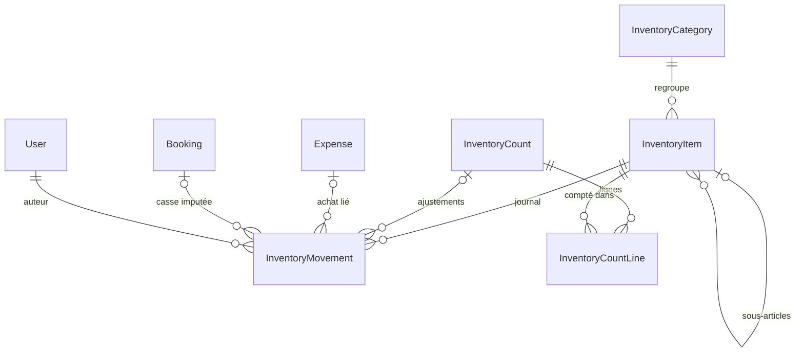

# Conception — Inventaire des biens de l'hôtel

**Statut :** proposition, à valider (voir [§ 10 Décisions à valider](#10-décisions-à-valider))
**Date :** 20 novembre 2026 · **Base :** version 2.5.2
**Choix de départ :** inventaire **global**, sans emplacements : une quantité par article pour
tout l'hôtel.

---

## 1. Objectif

Savoir à tout moment **ce que l'hôtel possède et en quelle quantité**, pour :

- ne jamais manquer de consommables (produits d'accueil, ménage, gaz…) ;
- repérer les pertes, la casse et l'usure (linge, vaisselle, équipements) ;
- préparer les achats à partir des seuils plutôt que de mémoire ;
- connaître la valeur approximative de ce que possède l'hôtel ;
- donner au personnel d'entretien (HOUSEKEEPING) des actions utiles dans l'application.

### Ce que couvre l'inventaire

| Famille | Exemples |
|---|---|
| **Équipements** | Lits, matelas, mobilier, électroménager, TV, ventilateurs, groupe électrogène, outillage, kayaks |
| **Linge et vaisselle** | Draps, serviettes, nappes, assiettes, verres, couverts |
| **Consommables** | Savon, papier toilette, produits ménagers, ampoules, gaz, carburant |

Tous les articles sont suivis de la même façon : **une quantité totale pour l'hôtel**. Un article
peut avoir des **sous-articles** (variantes) : « Drap 2 places » → « Drap 2 places rouge »,
« Drap 2 places blanc ». La quantité du parent est la somme de ses sous-articles.

### Hors périmètre de cette version

- **Emplacements** (où se trouve chaque objet : réserve, chambre 3, cuisine…). Voir § 9 pour les
  ajouter plus tard sans refonte.
- **Suivi à l'unité** des équipements (étiquette, numéro de série, garantie, réparation).
- **Produits revendus** aux clients (boissons, snacks) : liés aux suppléments facturés. Voir D1.
- **Objets trouvés** des clients : besoin différent, à traiter à part.
- **Comptabilité des stocks et des immobilisations** (amortissements). Voir D3.

---

## 2. Principes

1. **Un journal de mouvements immuable**, comme la comptabilité : on ne modifie jamais une
   quantité à la main, on enregistre un mouvement (entrée, consommation, casse, ajustement…). Une
   erreur se corrige par un mouvement inverse. La quantité affichée est la conséquence du journal.
2. **La quantité n'est jamais négative.** Toute sortie verrouille l'article (`SELECT … FOR UPDATE`)
   et vérifie la quantité disponible dans la même transaction.
3. **Le comptage physique fait foi.** Un inventaire compare le compté au théorique et génère des
   ajustements explicites, jamais une correction silencieuse.
4. **Saisie minimale sur le terrain.** Les gestes du personnel d'entretien tiennent en deux ou
   trois touches sur téléphone (l'application est déjà installable en PWA).
5. **Pas d'effet sur la comptabilité.** Les achats continuent de passer par les Dépenses ;
   l'inventaire peut seulement y faire référence.

---

## 3. Vocabulaire

| Terme | Définition |
|---|---|
| **Article** | Ce qu'on suit : « Drap 2 places », « Savon 20 g », « Ventilateur sur pied ». |
| **Sous-article** | Variante d'un article, dans la même table : « rouge » sous « Drap 2 places », affiché « Drap 2 places — rouge ». Un seul niveau. |
| **Article parent** | Article qui a des sous-articles. Il ne porte pas de quantité propre : la sienne est la somme de ses sous-articles. |
| **Article simple** | Article sans sous-article. Avec les sous-articles, ce sont les seuls à porter une quantité et des mouvements. |
| **Catégorie** | Regroupement d'articles (Literie, Vaisselle, Produits d'accueil…), rattaché à une famille. |
| **Quantité** | Nombre d'unités de l'article que possède l'hôtel. |
| **Mouvement** | Une ligne du journal : entrée, consommation, casse, perte, mise au rebut, ajustement. |
| **Inventaire** | Une campagne de comptage physique, validée par un responsable. |
| **Seuil** | Quantité minimale en dessous de laquelle l'article apparaît dans « À racheter ». |

---

## 4. Parcours

### P1 — Constituer l'inventaire de départ
Un responsable crée les catégories puis les articles avec leur quantité de départ, sur un écran
en tableau ou par import d'un fichier CSV. Chaque quantité de départ crée un mouvement `INITIAL`.

### P1 bis — Ajouter des variantes à un article
Depuis la fiche « Drap 2 places », un responsable ajoute « rouge » et « blanc ». Si l'article
avait déjà une quantité (par exemple 30 draps saisis avant de distinguer les couleurs), l'écran
demande comment la répartir entre les nouvelles variantes ; tant que les 30 ne sont pas répartis,
la création est refusée. La répartition est enregistrée comme des mouvements `RECLASSIFICATION`
dont la somme est nulle : le total de l'hôtel ne change pas.

### P2 — Recevoir un achat
Après un achat, l'accueil ou un responsable saisit une **entrée** : article, quantité, coût
unitaire (facultatif), et la dépense correspondante si elle existe dans l'écran Dépenses.

### P3 — Déclarer une consommation
Pour les consommables chers ou suivis de près (gaz, carburant), le personnel déclare ce qui a été
utilisé. Pour les petits consommables, la consommation se constate à l'inventaire (voir D2).

### P4 — Signaler une casse, une perte ou une mise au rebut
Depuis le téléphone : article, quantité, motif, et éventuellement la réservation concernée si un
client est en cause.

### P5 — Faire un inventaire
Un responsable ouvre une campagne. L'écran de comptage liste les articles (filtrables par
catégorie) avec un champ quantité et un bouton « conforme ». Plusieurs personnes peuvent compter
en parallèle, chacune sur des catégories différentes. À la validation, chaque écart devient un
mouvement `ADJUSTMENT`, et le rapport des écarts est conservé.

### P6 — Préparer les courses
La liste « À racheter » donne les articles sous leur seuil, avec la quantité pour revenir au
niveau souhaité, exportable en CSV.

---

## 5. Modèle de données



```prisma
enum InventoryFamily { EQUIPMENT  LINEN_TABLEWARE  CONSUMABLE }

enum InventoryMovementType {
  INITIAL      // quantité de départ
  PURCHASE     // entrée d'achat
  CONSUMPTION  // utilisé (consommables)
  BREAKAGE     // cassé
  LOSS         // disparu
  DISPOSAL     // mis au rebut (usure)
  ADJUSTMENT   // écart constaté à l'inventaire, signé
  RECLASSIFICATION // répartition de la quantité d'un article vers ses nouveaux sous-articles
}

enum InventoryCountStatus { IN_PROGRESS  VALIDATED  CANCELLED }

model InventoryCategory {
  id       String          @id @default(cuid())
  name     String          @unique
  family   InventoryFamily
  isActive Boolean         @default(true)
  items    InventoryItem[]
}

model InventoryItem {
  id         String            @id @default(cuid())
  // Sous-article : variante d'un article parent, dans la même table. Un seul niveau : un parent
  // n'a pas lui-même de parent (vérifié par le service).
  parent     InventoryItem?    @relation("ItemVariants", fields: [parentId], references: [id])
  parentId   String?
  variants   InventoryItem[]   @relation("ItemVariants")
  name       String            // « Drap 2 places » ; pour une variante, seulement la différence : « rouge »
                               // (affichée « Drap 2 places — rouge », voir D7)
  category   InventoryCategory @relation(fields: [categoryId], references: [id])
  categoryId String            // une variante a toujours la catégorie de son parent
  unit       String            @default("pièce")   // une variante a toujours l'unité de son parent
  // Cache du journal, mis à jour dans la même transaction que chaque mouvement, recalculable
  // depuis InventoryMovement. Jamais négatif (contrainte CHECK dans la migration). Toujours 0 sur
  // un article parent : sa quantité affichée est la somme de ses variantes, calculée à la lecture.
  quantity   Int               @default(0)
  // Seuil « À racheter ». Sur un parent, il porte sur le total des variantes (« au moins 40 draps,
  // toutes couleurs ») ; sur une variante, sur elle seule. Les deux peuvent coexister.
  minStock   Int?
  unitCost   Int?                                  // dernier coût connu, en Ar ; une variante sans coût prend celui du parent
  isActive   Boolean           @default(true)      // suppression douce, comme Extra
  createdAt  DateTime          @default(now())
  updatedAt  DateTime          @updatedAt
  movements  InventoryMovement[]

  @@index([parentId])
}
// Unicité du nom, posée en index partiels dans la migration (Postgres considère les NULL comme
// distincts, un @@unique([parentId, name]) laisserait passer deux articles racines homonymes) :
//   CREATE UNIQUE INDEX ... ON "InventoryItem" (lower("name")) WHERE "parentId" IS NULL;
//   CREATE UNIQUE INDEX ... ON "InventoryItem" ("parentId", lower("name")) WHERE "parentId" IS NOT NULL;

model InventoryMovement {
  id          String                @id @default(cuid())
  type        InventoryMovementType
  item        InventoryItem         @relation(fields: [itemId], references: [id])
  itemId      String
  // Variation de la quantité : positive pour INITIAL et PURCHASE, négative pour CONSUMPTION,
  // BREAKAGE, LOSS et DISPOSAL, de signe libre pour ADJUSTMENT. Jamais 0.
  delta       Int
  quantityAfter Int                                // quantité après le mouvement, pour l'historique
  unitCost    Int?
  reason      String                @default("")
  expenseId   String?                              // achat lié (écran Dépenses)
  bookingId   String?                              // casse imputable à un séjour
  countId     String?                              // ajustement issu d'un inventaire
  createdById String
  createdAt   DateTime              @default(now())

  @@index([itemId, createdAt])
  @@index([type, createdAt])
}

model InventoryCount {
  id            String               @id @default(cuid())
  number        String               @unique   // INV-2026-0001 (nextDocumentNumber)
  status        InventoryCountStatus @default(IN_PROGRESS)
  createdById   String
  validatedById String?
  createdAt     DateTime             @default(now())
  validatedAt   DateTime?
  lines         InventoryCountLine[]
}

model InventoryCountLine {
  id          String    @id @default(cuid())
  countId     String
  itemId      String
  expectedQty Int                     // quantité théorique au moment du comptage
  countedQty  Int?                    // null = pas encore compté
  countedById String?
  countedAt   DateTime?
  note        String    @default("")

  @@unique([countId, itemId])
}
```

### Règles de cohérence

| Mouvement | Sens | Qui |
|---|---|---|
| `INITIAL` | + | Responsable, seulement tant que l'article n'a aucun autre mouvement |
| `PURCHASE` | + | Accueil, responsable |
| `CONSUMPTION`, `BREAKAGE` | − | Tout le personnel |
| `LOSS`, `DISPOSAL` | − | Responsable |
| `ADJUSTMENT` | ± | Uniquement par la validation d'un inventaire |
| `RECLASSIFICATION` | ± | Uniquement à la création des premières variantes d'un article qui avait une quantité |

**Articles et variantes**
- **Seuls les articles simples et les variantes portent une quantité et des mouvements.** Un
  mouvement ou une ligne d'inventaire sur un article parent est refusé (400).
- Un seul niveau : on ne peut pas ajouter de variante à une variante.
- Une variante hérite de la catégorie et de l'unité de son parent ; changer celles du parent
  les change pour toutes ses variantes.
- Ajouter la première variante à un article dont la quantité n'est pas nulle impose de répartir
  toute cette quantité entre les variantes créées (mouvements `RECLASSIFICATION`, somme nulle).
- Désactiver un parent impose que toutes ses variantes aient une quantité nulle ; il les
  désactive avec lui. Un parent dont toutes les variantes sont désactivées redevient un article
  simple, à quantité nulle.
- « À racheter » liste une variante sous son propre seuil, et un parent dont le total est sous le
  seuil du parent.

**Général**

- Une sortie supérieure à la quantité disponible est refusée (409).
- Un seul inventaire `IN_PROGRESS` à la fois.
- **Validation d'un inventaire** : pour chaque ligne comptée, écart = compté − quantité **au
  moment de la validation**, dans une transaction qui verrouille les articles concernés. Si un
  article a bougé après avoir été compté, l'écran le signale avant validation. Les lignes non
  comptées ne génèrent aucun ajustement.
- Un article dont la quantité n'est pas nulle ne peut pas être désactivé ; on le met d'abord à
  zéro par une mise au rebut ou un inventaire.
- La quantité de `InventoryItem` est toujours égale à la somme des `delta` de ses mouvements
  (vérifié par un test).

---

## 6. API

Routes sous `/api/inventory`, avec `authenticate` + `can(...)`, schémas Zod dans
`validation/inventory.schema.ts`.

| Méthode et route | Rôle | Permission |
|---|---|---|
| `GET /categories` · `POST` · `PATCH /:id` | Catégories | `inventory.view` / `inventory.manage_catalog` |
| `GET /items` | Articles en arbre : chaque parent avec ses variantes et son total (filtres : catégorie, famille, actif, `belowMin`, recherche sur le parent et les variantes) | `inventory.view` |
| `POST /items` · `PATCH /:id` | Créer un article (avec quantité de départ), modifier nom, seuil, unité | `inventory.manage_catalog` |
| `POST /items/:id/variants` | Ajouter une ou plusieurs variantes ; corps avec la répartition de la quantité existante si l'article en avait | `inventory.manage_catalog` |
| `GET /items/:id/movements` | Historique d'un article | `inventory.view` |
| `POST /movements` | Un mouvement ; corps discriminé par `type` | selon le type, voir § 7 |
| `GET /movements` | Journal paginé (article, type, période, auteur) | `inventory.view` |
| `POST /import` | Import CSV de départ : aperçu, puis confirmation | `inventory.manage_catalog` |
| `POST /counts` · `GET /counts` · `GET /counts/:id` | Inventaires | `inventory.count` / `inventory.validate_count` pour ouvrir |
| `PATCH /counts/:id/lines` | Saisie de quantités comptées (par lot) | `inventory.count` |
| `POST /counts/:id/validate` · `POST /counts/:id/cancel` | Clôture d'un inventaire | `inventory.validate_count` |
| `GET /export.csv` | Articles ou journal en CSV | `inventory.view` |

Services : `inventory.service.ts` (catégories, articles, import),
`inventoryMovement.service.ts` (**seul point qui modifie `InventoryItem.quantity`**),
`inventoryCount.service.ts` (campagnes). Le numéro d'inventaire réutilise
`lib/documentNumber.ts` (ajouter `'InventoryCount'` à `NumberedTable`).

---

## 7. Permissions

À déclarer dans `prisma/seedPermissions.ts` **et** dans une migration SQL idempotente.

| Clé | Ce qu'elle autorise | Rôles par défaut |
|---|---|---|
| `inventory.view` | Voir les articles, les quantités et le journal (sans les coûts) | Tous |
| `inventory.record_usage` | Déclarer une consommation ou une casse | Tous, dont HOUSEKEEPING |
| `inventory.receive` | Entrées d'achat | ADMIN, MANAGER, GERANT |
| `inventory.count` | Saisir des quantités dans un inventaire | Tous |
| `inventory.validate_count` | Ouvrir, valider ou annuler un inventaire | ADMIN, MANAGER |
| `inventory.dispose` | Perte et mise au rebut | ADMIN, MANAGER |
| `inventory.manage_catalog` | Catégories, articles, seuils, import | ADMIN, MANAGER |
| `inventory.view_value` | Voir coûts et valeur de l'inventaire | ADMIN, MANAGER |

Toutes les écritures sont déjà tracées par le journal d'audit (`middleware/auditLog.ts`).

---

## 8. Écrans (back-office)

| Écran | Contenu |
|---|---|
| **Inventaire** (`/inventory`), entrée de menu | Onglets **Articles** (liste dépliable : le parent affiche son total, ses variantes en dessous ; seuil, badge « à racheter », filtres catégorie et famille), **Mouvements** (journal), **Inventaires** (campagnes) |
| **Fiche article** | Quantité (ou total et détail par variante), seuil, coût, historique des mouvements (de toutes les variantes pour un parent), valeur (si permission), bouton « Ajouter des variantes » |
| **Signaler** (bouton flottant sur mobile) | Deux gros boutons : Utilisé, Cassé / perdu. Recherche d'article : choisir un parent ouvre directement le choix de la variante. Quantité en + / − |
| **Recevoir un achat** | Article, quantité, coût, dépense liée |
| **Comptage** | Articles par catégorie, variantes regroupées sous leur parent avec sous-total, champ quantité, bouton « conforme », avancement |
| **Rapport d'inventaire** | Écarts par article et leur valeur, imprimable (même principe que la facture) |
| **À racheter** | Articles sous le seuil et quantité à acheter, export CSV |
| **Tableau de bord** | Carte « À racheter » avec le nombre d'articles concernés |

Côté client, le découpage habituel : `api/inventory.ts`, `hooks/useInventory.ts`, pages dans
`pages/inventory/`, textes dans les trois fichiers de `locales/`, fenêtres via `components/Modal.tsx`.

---

## 9. Découpage et évolutions

| Lot | Contenu |
|---|---|
| **1 — Inventaire global** | Catégories, articles et variantes, quantité de départ et import CSV (colonne « parent » facultative), mouvements (entrée, consommation, casse, perte, rebut), seuils et « À racheter », journal, écran « Signaler », permissions |
| **2 — Inventaires** | Campagnes de comptage, rapport d'écarts |
| **Plus tard, si besoin** | Emplacements, suivi à l'unité, entrée de stock depuis une dépense, casse facturée au client, QR codes, valorisation comptable |

**Ajouter les emplacements plus tard** sans refonte : créer `InventoryLocation` et une table
`InventoryStock (itemId, locationId, quantity)`, déplacer chaque `InventoryItem.quantity` vers un
emplacement par défaut « Hôtel », ajouter `fromLocationId` / `toLocationId` aux mouvements
(nullables pour l'historique) et le type `TRANSFER`. Le journal existant reste valable tel quel.

### Tests d'intégration à prévoir

- Deux sorties simultanées sur le même article : l'une est refusée, la quantité ne passe jamais
  sous zéro.
- Une sortie supérieure à la quantité est refusée (409).
- La quantité d'un article est égale à la somme des `delta` de son journal.
- Validation d'inventaire : ajustements exacts, lignes non comptées ignorées, pas de double
  validation, un seul inventaire ouvert à la fois.
- Désactivation d'un article dont la quantité n'est pas nulle : refusée.
- Variantes : mouvement sur un parent refusé ; variante d'une variante refusée ; première variante
  d'un article avec quantité refusée si la répartition n'est pas complète, acceptée sinon avec un
  total inchangé ; deux articles racines homonymes refusés, mais « rouge » permis sous deux
  parents différents ; seuil du parent calculé sur le total des variantes.
- HOUSEKEEPING peut déclarer une consommation ou une casse, pas une entrée d'achat, une perte ou
  une mise au rebut.

---

## 10. Décisions à valider

| # | Question | Recommandation |
|---|---|---|
| **D1** | Inclure les produits revendus (boissons, snacks) ? | **Non pour l'instant.** Ils demandent un lien avec les suppléments facturés et une sortie automatique à la facturation. |
| **D2** | Les petits consommables : déclarer chaque utilisation, ou constater la consommation à l'inventaire ? | **À l'inventaire.** Déclarer chaque savon ne sera jamais tenu. La déclaration reste disponible pour les produits chers (gaz, carburant). |
| **D3** | L'inventaire passe-t-il des écritures comptables ? | **Non.** Les achats restent des dépenses (606100). À revoir avec le comptable pour les gros équipements (immobilisation, amortissement). |
| **D4** | À quelle fréquence compter ? | Consommables et linge : chaque mois. Tout : une fois par an, avant la haute saison. |
| **D5** | Qui voit « À racheter » ? | Carte sur le tableau de bord des responsables ; notification push en option plus tard. |
| **D6** | Combien de niveaux de sous-articles ? | **Un seul** (article → variante) : il couvre « drap → drap rouge » et garde des écrans simples. Plusieurs niveaux (« Linge → Drap → Drap rouge ») font doublon avec les catégories. |
| **D7** | Nom d'une variante : complet (« Drap 2 places rouge ») ou seulement la différence (« rouge ») ? | **Seulement la différence en saisie, affichée en complet** (« Drap 2 places — rouge ») : pas de répétition à la saisie, et toujours lisible seule dans le journal. C'est ce que suppose le schéma (`name = "rouge"`). |
